# Instride

## Pantau Wellbeing-mu, Mulai dari Hari Ini

**Project Senior Project TI**

**Aplikasi:** [Buka Instride](app/) · [Campus Dashboard](app/campus-dashboard)

**Instansi:** Departemen Teknologi Elektro dan Teknologi Informasi, Fakultas Teknik, Universitas Gadjah Mada

Instride adalah aplikasi web untuk membantu mahasiswa memantau wellbeing secara personal sekaligus membantu institusi memahami tren kesejahteraan mahasiswa secara agregat dan berorientasi pada privasi.

## Anggota Kelompok

| Nama                              | NIM                | Peran                           |
| --------------------------------- | ------------------ | ------------------------------- |
| Marcelinus Dinoglide Yoga Prakoso | 24/533842/TK/59152 | Cloud Engineer, Project Manager |
| Muhammad Izzuddin Prakoso         | 24/537712/TK/59618 | Software Engineer               |
| Raka Bagus Samudra                | 24/543213/TK/60349 | AI Engineer, UI/UX Designer     |

## Modul 1: Perumusan Masalah

### Nama Produk

**Instride**

### Jenis Produk

Instride merupakan aplikasi web wellbeing mahasiswa berbasis kecerdasan buatan. Aplikasi ini menggabungkan mood tracker, jurnal harian, analisis sentimen berbahasa Indonesia, dashboard personal, dan dashboard agregat untuk institusi.

### Latar Belakang dan Permasalahan

Kesehatan mental mahasiswa menjadi isu yang semakin mendesak. Beban akademik seperti tugas kuliah dan skripsi dapat memicu stres, kecemasan, dan depresi. Walaupun prevalensinya tinggi, mahasiswa tidak selalu segera mencari bantuan karena khawatir terhadap penilaian sosial dan stigma ketika membicarakan masalah pribadi.

Pemantauan mood dan jurnal digital dapat membantu mahasiswa mengenali pola emosinya secara berkala. Namun, institusi juga membutuhkan informasi tentang tren wellbeing komunitas untuk menentukan dukungan yang tepat. Tantangannya adalah menyediakan insight tersebut tanpa membuka identitas atau isi jurnal pribadi mahasiswa.

Permasalahan yang hendak dijawab Instride adalah:

1. Bagaimana membantu mahasiswa memantau wellbeing secara sederhana dan konsisten?
2. Bagaimana menganalisis sentimen dan emosi jurnal berbahasa Indonesia secara otomatis?
3. Bagaimana mengubah data individual menjadi tren wellbeing komunitas tanpa mengekspos privasi mahasiswa?
4. Bagaimana menyajikan informasi tersebut dalam sistem cloud dan dashboard yang mudah dipahami?

### Ide Solusi

Instride menyediakan dua alur yang saling terhubung:

- **Sisi mahasiswa:** mahasiswa mencatat mood dan jurnal harian melalui form yang ringkas. Jurnal dianalisis menggunakan model NLP berbahasa Indonesia, seperti IndoBERT, lalu hasilnya ditampilkan sebagai riwayat dan tren wellbeing personal.
- **Sisi kampus:** data diproses menjadi statistik agregat, seperti rata-rata mood dan distribusi sentimen per periode. Unit konseling dapat melihat tren komunitas tanpa mengakses identitas maupun isi jurnal mahasiswa.

Dengan pendekatan ini, mahasiswa mendapat ruang refleksi mandiri, sedangkan institusi memperoleh dasar pengambilan keputusan yang lebih proaktif dan tetap menjaga privasi.

#### Rancangan Fitur

| Fitur                        | Keterangan                                                                                                            |
| ---------------------------- | --------------------------------------------------------------------------------------------------------------------- |
| Login dan role-based access  | Membedakan hak akses mahasiswa dan konselor sesuai kewenangan.                                                        |
| Mood tracker dan journal     | Mencatat mood serta refleksi harian melalui satu form yang ringkas.                                                   |
| Personal dashboard dan trend | Menampilkan riwayat mood dan sentimen untuk refleksi mandiri.                                                         |
| AI sentiment analysis        | Mengklasifikasikan jurnal berbahasa Indonesia menjadi sentimen positif, netral, atau negatif dengan bantuan IndoBERT. |
| Data aggregation engine      | Menghasilkan statistik agregat tanpa menyertakan identitas atau isi jurnal personal.                                  |
| Campus dashboard             | Menampilkan tren wellbeing komunitas bagi unit konseling dalam bentuk visual yang mudah dipahami.                     |

### Analisis Kompetitor

| Kompetitor    | Jenis dan target pengguna                                                    | Kelebihan                                                                                        | Kekurangan dibanding Instride                                                                            |
| ------------- | ---------------------------------------------------------------------------- | ------------------------------------------------------------------------------------------------ | -------------------------------------------------------------------------------------------------------- |
| **MoodMate**  | Aplikasi wellbeing berbasis AI untuk individu yang ingin memantau wellbeing. | Ekosistem personal wellbeing matang, smart tags, dan personalisasi kuat.                         | Berfokus pada individu; tidak memiliki konteks akademik dan alur kerja institusi.                        |
| **KALM**      | Platform kesehatan mental dan konseling psikologis untuk individu.           | Menyediakan konseling psikolog, journal, wellbeing tracker, dan layanan psikologis terintegrasi. | Berorientasi B2C; belum berfokus pada analitik tren wellbeing tingkat institusi.                         |
| **Tenang AI** | Platform dukungan emosional berbasis AI untuk individu.                      | Dukungan cepat, dapat diakses kapan saja, dan scalable.                                          | Tidak menggantikan psikolog; belum terintegrasi dengan layanan konseling kampus atau analitik komunitas. |

#### Keunggulan Instride

Instride menggabungkan pemantauan wellbeing personal, analisis AI berbahasa Indonesia, dan analitik agregat untuk kampus dalam satu alur. Nilai pembeda utamanya adalah dukungan pengambilan keputusan institusi yang tetap menjaga kerahasiaan data mahasiswa.

> Instride merupakan alat bantu pemantauan dan refleksi awal, bukan pengganti diagnosis atau layanan psikolog profesional.

## Modul 2: SDLC & Git

### Metodologi SDLC

**Metodologi:** Agile (Scrum)

**Alasan:** Scrum dipilih karena Instride memiliki beberapa fitur yang dapat dikembangkan secara bertahap, kebutuhan pengguna (mahasiswa dan kampus) dapat memerlukan penyesuaian, serta pengembangan AI membutuhkan proses pengujian dan evaluasi berulang. Scrum memungkinkan tim mengembangkan produk dalam sprint, melakukan evaluasi secara berkala, dan menyesuaikan prioritas selama proyek berlangsung.

### Tujuan Produk

Instride bertujuan membantu mahasiswa memantau wellbeing secara personal melalui pencatatan mood dan jurnal harian serta analisis sentimen berbasis AI, sekaligus membantu unit konseling kampus memahami tren wellbeing mahasiswa secara agregat dan anonim sebagai dasar pengambilan keputusan dan dukungan yang lebih proaktif. Fitur inti (MVP) dipastikan berjalan solid terlebih dahulu sebelum fitur agregasi tingkat kampus dikembangkan lebih lanjut.

### Pengguna Potensial

| Pengguna                                | Kebutuhan Utama                                                                                                   | Pain Point yang Diatasi                                                                                  |
| --------------------------------------- | ----------------------------------------------------------------------------------------------------------------- | -------------------------------------------------------------------------------------------------------- |
| Mahasiswa (pengguna utama)              | Mencatat mood & jurnal harian secara cepat dan privat; melihat tren wellbeing pribadi tanpa evaluasi manual konselor | Enggan bercerita langsung ke psikolog/konselor karena stigma sosial; sulit memantau kondisi diri secara konsisten |
| Unit Konseling / BK Kampus (sekunder)   | Melihat tren wellbeing mahasiswa secara agregat & anonim sebagai dasar perencanaan program dukungan               | Tidak memiliki data real-time untuk mendeteksi kebutuhan dukungan secara proaktif; bergantung pada laporan manual/survei |

### Use Case Diagram

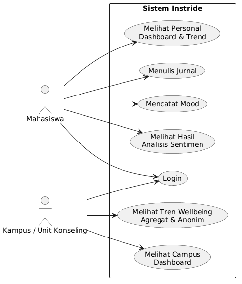

### Functional Requirements

| FR   | Deskripsi |
| ---- | --------- |
| FR 1 | Sistem harus memungkinkan mahasiswa melakukan login, mencatat mood, mencatat jurnal harian, serta melihat personal dashboard yang menampilkan riwayat mood dan perkembangan wellbeing dari waktu ke waktu. |
| FR 2 | Sistem harus dapat menganalisis sentimen jurnal mahasiswa menggunakan model IndoBERT (via Hugging Face Inference API) dan menampilkan hasilnya pada dashboard personal, dengan fallback sentimen sederhana jika API tidak tersedia. |
| FR 3 | Sistem harus dapat mengagregasikan data mood dan sentimen mahasiswa secara anonim serta menampilkannya pada campus dashboard, tanpa mengakses identitas maupun isi jurnal pribadi mahasiswa. |
| FR 4 | Sistem harus memastikan data identitas dan isi jurnal pribadi mahasiswa tidak dapat diakses oleh pihak kampus; hanya data agregat dan anonim yang ditampilkan pada Campus Dashboard. |
| FR 5 | Sistem harus menerapkan role-based access (Supabase Auth & Row Level Security) sehingga mahasiswa dan unit konseling hanya dapat menggunakan fitur sesuai perannya. |
| FR 6 | Sistem harus menyimpan riwayat mood dan jurnal mahasiswa agar dapat ditampilkan sebagai grafik tren pada Personal Dashboard. |
| FR 7 | Sistem harus menyediakan halaman Riwayat Jurnal yang menampilkan seluruh entri mood/jurnal, dengan filter rentang tanggal dan kategori sentimen. |
| FR 8 | Sistem harus menyediakan halaman Profil & Pengaturan untuk mengubah data profil, password, dan preferensi notifikasi pengingat harian. |
| FR 9 | Sistem harus menyediakan halaman Sumber Daya & Bantuan berisi tips wellbeing serta kontak unit konseling kampus dan layanan kesehatan jiwa nasional, yang dapat diakses tanpa bergantung pada hasil analisis sentimen. |

### Entity Relationship Diagram

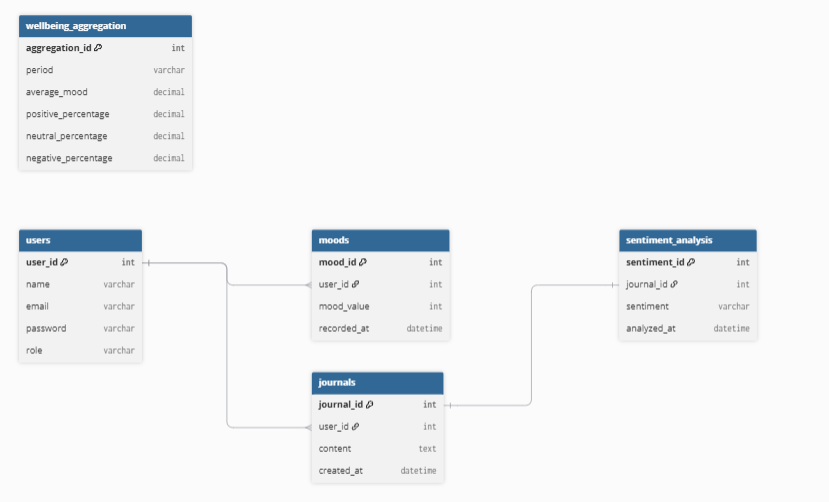

### Low-Fidelity Wireframe

| Halaman | Wireframe |
| ------- | --------- |
| Landing Page | 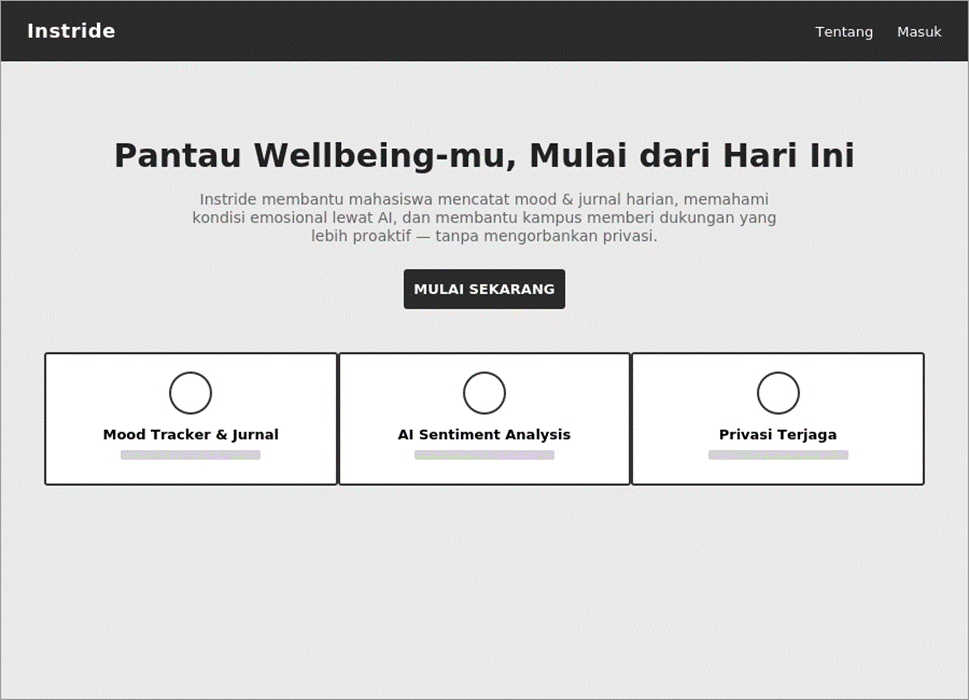 |
| Login | 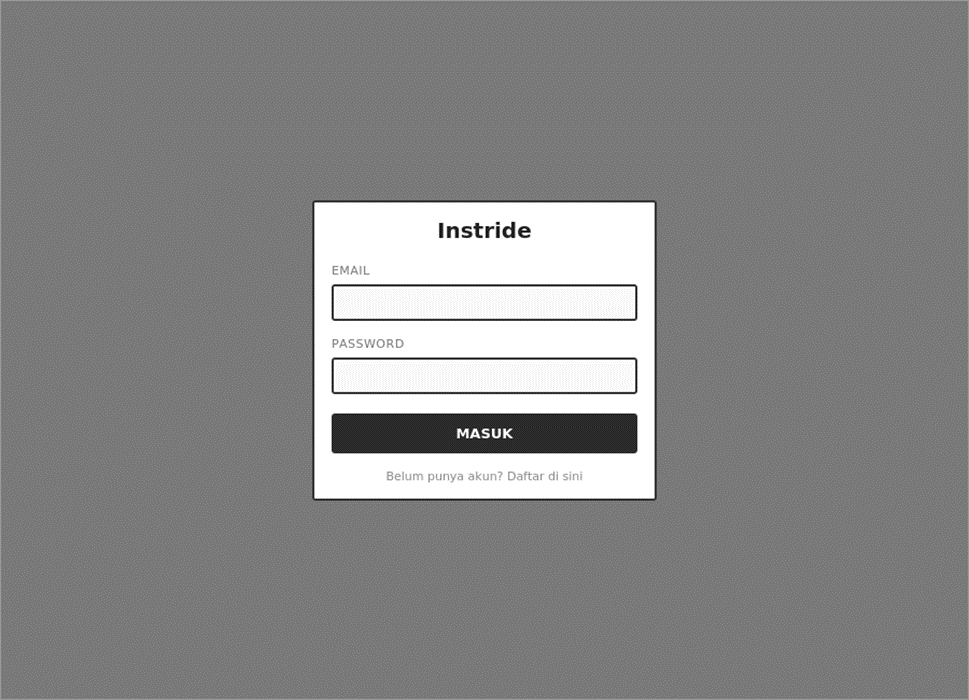 |
| Register | 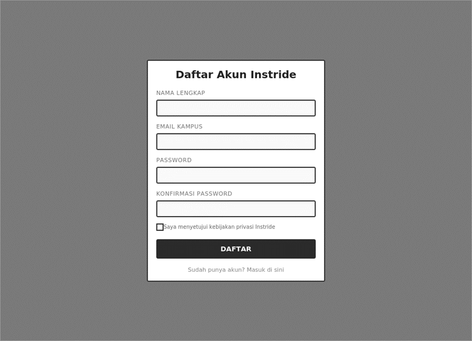 |
| Mood & Journal Input | 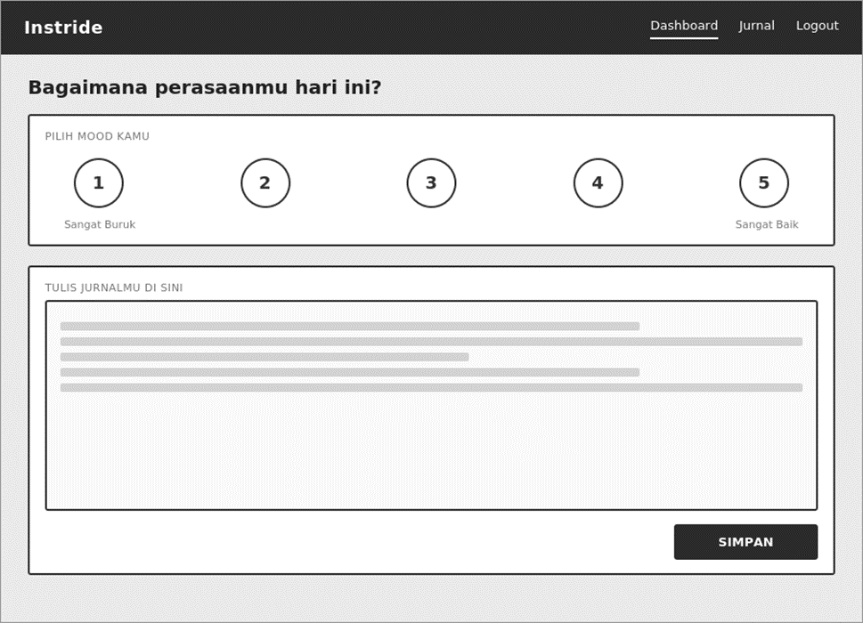 |
| Personal Dashboard | 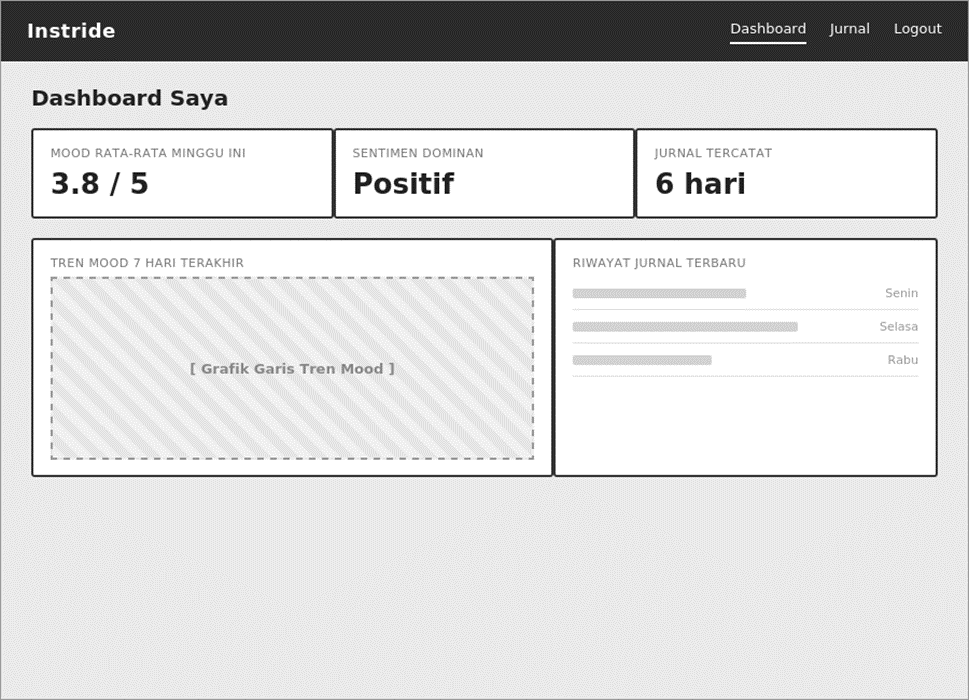 |
| Riwayat Jurnal | 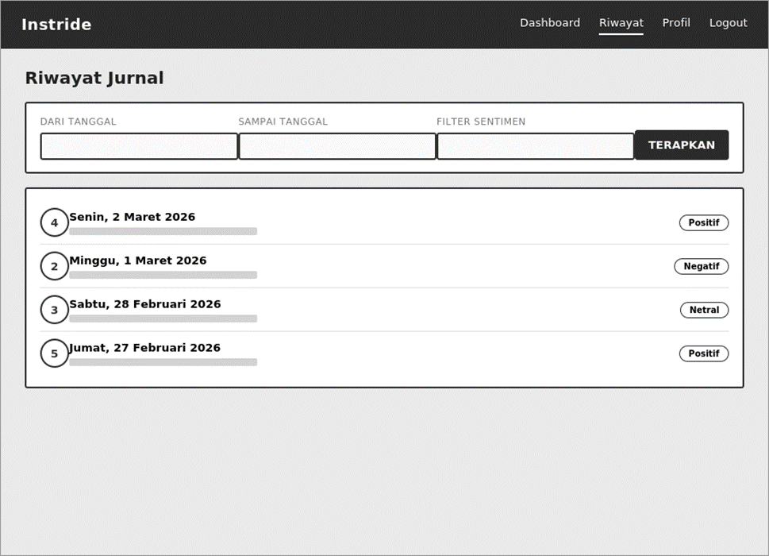 |
| Profil & Pengaturan | 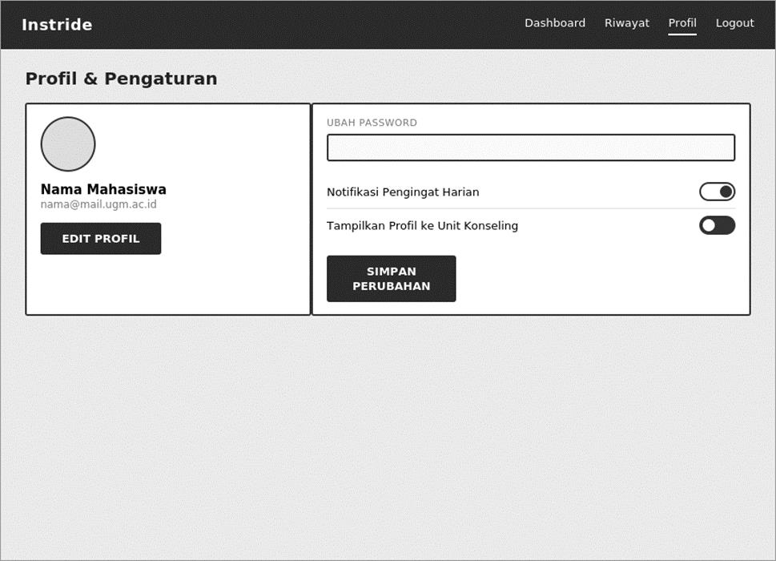 |
| Sumber Daya & Bantuan | 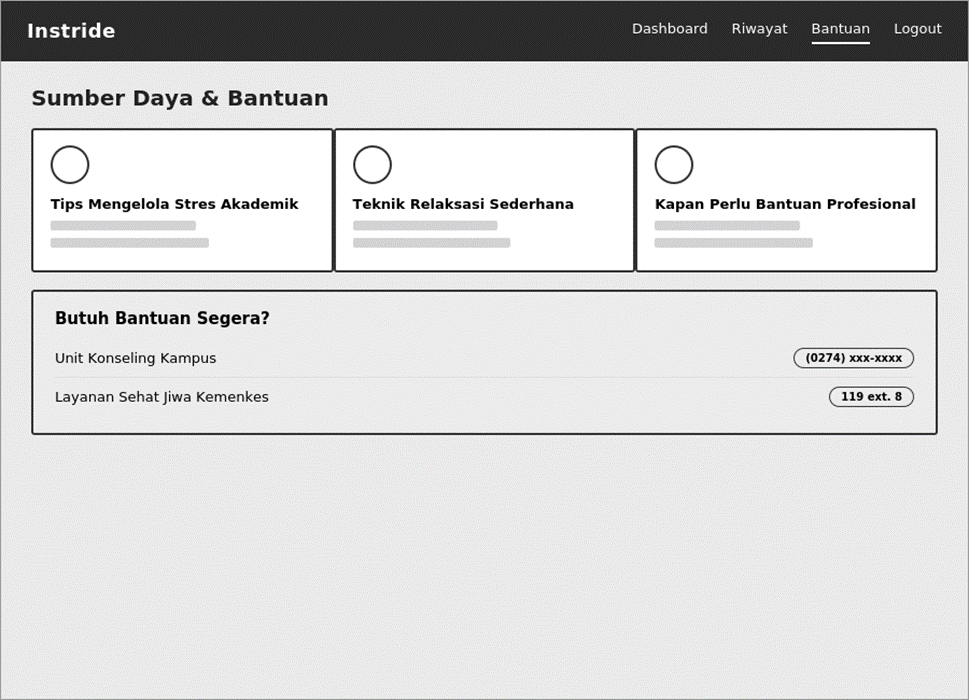 |
| Campus Dashboard | 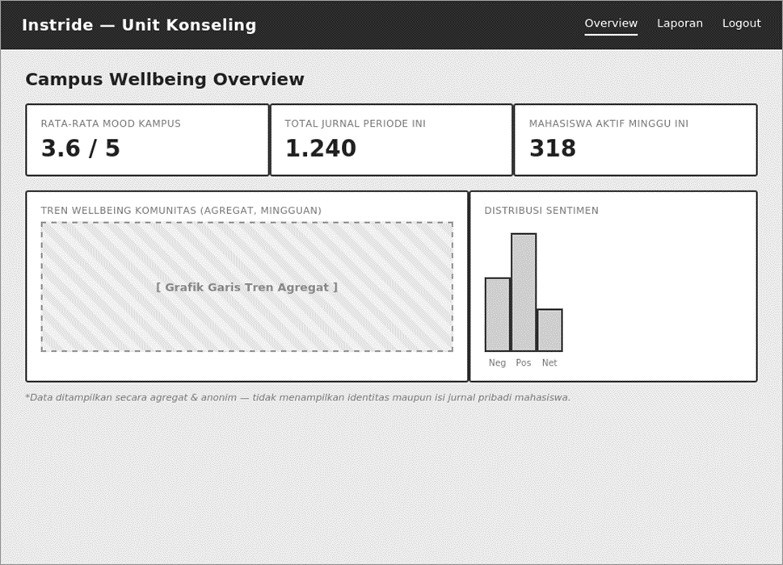 |

### Gantt Chart (1 Semester)

| Kegiatan | 1 | 2 | 3 | 4 | 5 | 6 | 7 | 8 | 9 | 10 | 11 | 12 |
| -------- | - | - | - | - | - | - | - | - | - | -- | -- | -- |
| Finalisasi requirement & setup tech stack (Next.js + Supabase) | ■ | | | | | | | | | | | |
| UI/UX wireframe, setup repo & deploy skeleton | | ■ | | | | | | | | | | |
| Sprint 1: Autentikasi, register & role-based access | | | ■ | ■ | | | | | | | | |
| Sprint 2: Mood tracker, journal & integrasi AI sentiment | | | | | ■ | ■ | | | | | | |
| Sprint 3: Personal dashboard, trend & riwayat jurnal | | | | | | | ■ | | | | | |
| Sprint 4 (stretch): Data aggregation & campus dashboard | | | | | | | | ■ | ■ | | | |
| Sprint 5 (stretch, paralel): Profil, pengaturan & self-help | | | | | | | | ■ | ■ | | | |
| Testing (unit + manual) & bug fixing | | | | | | | | | ■ | | | |
| UI polish & penanganan edge case | | | | | | | | | | ■ | | |
| Final QA & dokumentasi teknis | | | | | | | | | | | ■ | |
| Evaluasi & persiapan presentasi akhir | | | | | | | | | | | | ■ |
| CI (GitHub Actions) & CD — berkelanjutan | | ■ | ■ | ■ | ■ | ■ | ■ | ■ | ■ | ■ | ■ | ■ |
